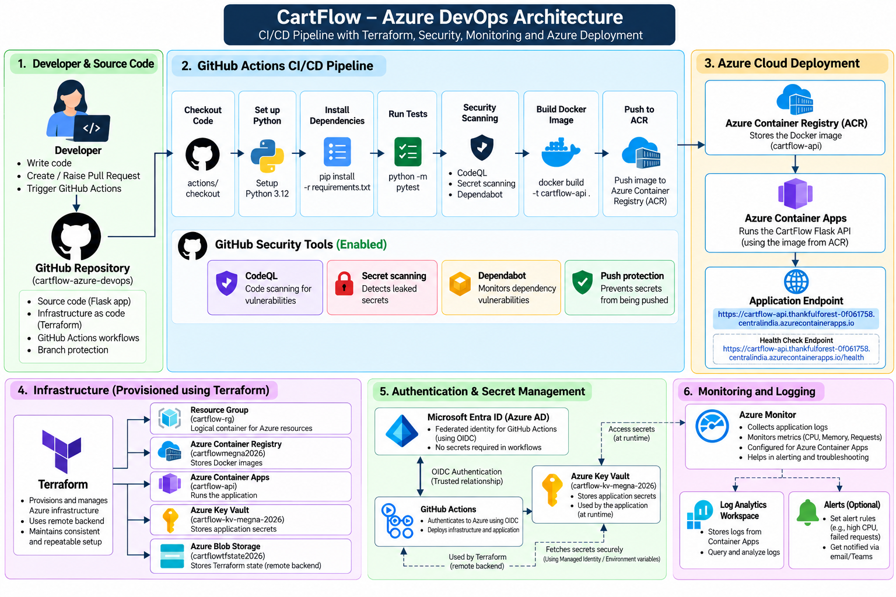

# CartFlow – Azure DevOps Implementation

**Skillfyme DevOps Assignment**

**Author:** Megna Pradeep
**GitHub:** [Megna0710](https://github.com/Megna0710)
**Repository:** [cartflow-azure-devops](https://github.com/Megna0710/cartflow-azure-devops)

---

## 1. Project Overview

CartFlow is a Python Flask-based REST API application that demonstrates an end-to-end DevOps implementation using Microsoft Azure.

The project focuses on containerization, automated application testing, CI/CD, Infrastructure as Code (IaC), cloud deployment, security integration, and monitoring.

The original project repository included AWS-oriented deployment configurations. I adapted the deployment approach to use Microsoft Azure while retaining the core Flask application and Docker-based containerization.

The application is deployed on **Azure Container Apps**, with container images stored in **Azure Container Registry (ACR)**. Infrastructure is managed using Terraform, and GitHub Actions automates application delivery and infrastructure validation.

**Live Application:**
https://cartflow-api.thankfulforest-0f061758.centralindia.azurecontainerapps.io

**Health Check:**
https://cartflow-api.thankfulforest-0f061758.centralindia.azurecontainerapps.io/health

---

## 2. Problem Statement

The objective of this assignment is to implement a practical DevOps workflow for a containerized application by integrating cloud infrastructure, automation, deployment, security, and monitoring.

The project addresses the following requirements:

- Package the Flask application into a Docker container.
- Establish a cloud-based container image registry.
- Deploy the application to a managed cloud container platform.
- Automate application testing and deployment through CI/CD.
- Provision and manage infrastructure using Infrastructure as Code.
- Implement secure authentication between GitHub Actions and Azure.
- Manage application secrets securely.
- Integrate automated security scanning.
- Monitor application logs and infrastructure metrics.

The original repository contained AWS-oriented deployment configurations. The implementation was adapted to Microsoft Azure to demonstrate an alternative cloud deployment architecture.

---

## 3. Solution Approach

The project was implemented using the following approach.

### 3.1 Application Containerization

The Python Flask application was packaged into a Docker image.

Docker provides a consistent runtime environment by packaging the application and its dependencies together.

### 3.2 Azure Container Registry

Azure Container Registry (ACR) was created to store and manage the application's Docker images.

Registry: `cartflowmegna2026.azurecr.io`

### 3.3 Azure Container Apps Deployment

The containerized application was deployed to Azure Container Apps.

The application is exposed through HTTPS ingress, with port `5000` configured as the target port.

### 3.4 Infrastructure as Code

Terraform was used to define and manage Azure infrastructure.

Azure Blob Storage was configured as the Terraform remote state backend to support centralised state management.

### 3.5 CI/CD Automation

GitHub Actions workflows were configured for application testing, container image building and publishing, Azure deployment, Terraform validation, and controlled infrastructure deployment.

### 3.6 Identity and Secret Management

GitHub Actions uses Microsoft Entra ID federated identity authentication through OpenID Connect (OIDC).

Azure Key Vault is configured for project secret storage and integration with the application infrastructure.

### 3.7 Security and Monitoring

GitHub CodeQL and repository security features provide automated security checks.

Azure Log Analytics collects Container Apps logs, while Azure Monitor is configured with a CPU metric alert and an email action group.

---

## 4. Architecture



### Application and deployment flow

1. Developers push code changes or create pull requests in GitHub.
2. GitHub Actions checks out the repository and prepares the Python environment.
3. Automated application tests and configured security checks are executed.
4. Docker builds the application image.
5. The image is pushed to Azure Container Registry.
6. The deployment workflow updates Azure Container Apps to use the required image.
7. Terraform manages the Azure infrastructure and stores its state in Azure Blob Storage.
8. GitHub Actions authenticates to Azure using Microsoft Entra ID federated credentials.
9. Azure Container Apps sends application and system logs to Log Analytics.
10. Azure Monitor evaluates the configured CPU alert and uses an action group for email notifications.

### Azure Resources

| Resource | Name |
|---|---|
| Resource Group | `cartflow-rg` |
| Azure Container App | `cartflow-api` |
| Container Apps Environment | `cartflow-env` |
| Azure Container Registry | `cartflowmegna2026` |
| Log Analytics Workspace | `workspacecartflowrgb3e8` |
| Azure Key Vault | `cartflow-kv-megna-2026` |
| Terraform State Storage Account | `cartflowtfstate2026` |
| Terraform State Container | `tfstate` |
| Terraform State Blob | `cartflow-terraform.tfstate` |
| Azure Monitor CPU Alert | `CartFlow-High-CPU-Alert` |
| Alert Action Group | `cartflow-alerts` |

---

## 5. Technology Stack

| Area | Technologies |
|---|---|
| Application | Python, Flask |
| Containerization | Docker |
| Container Registry | Azure Container Registry |
| Container Hosting | Azure Container Apps |
| CI/CD | GitHub Actions |
| Infrastructure as Code | Terraform |
| Cloud Platform | Microsoft Azure |
| Identity and Authentication | Microsoft Entra ID, OIDC |
| Secret Management | Azure Key Vault |
| Terraform Remote State | Azure Blob Storage |
| Logging | Azure Container Apps Logs, Log Analytics |
| Monitoring | Azure Monitor |
| Security Scanning | GitHub CodeQL |
| Version Control | Git, GitHub |

---

## 6. Application Endpoints

| Endpoint | Description |
|---|---|
| `/` | Application root endpoint |
| `/health` | Application health-check endpoint |

**Live health check:**
https://cartflow-api.thankfulforest-0f061758.centralindia.azurecontainerapps.io/health

The health endpoint has previously returned healthy status for the API, catalog, and orders checks.

---

## 7. Dependencies and Prerequisites

The following tools are required to work with the project locally.

| Tool | Purpose |
|---|---|
| Git | Source code management |
| Python 3.12 or compatible version | Application runtime |
| pip | Python dependency installation |
| Docker Desktop | Container image building and local execution |
| Visual Studio Code | Development environment |
| Azure CLI | Azure resource management |
| Terraform | Infrastructure provisioning |
| GitHub account | Source control and CI/CD |

### Python dependencies

The application's Python dependencies are defined in:

`app/requirements.txt`

Install them using:

```bash
pip install -r app/requirements.txt
```

### Azure and GitHub configuration

For cloud deployment, the following must also be configured:

- An active Azure subscription.
- Azure resource group and required Azure services.
- Azure Container Registry.
- Azure Container Apps environment.
- Microsoft Entra ID application and federated identity credentials.
- Required Azure RBAC permissions.
- Azure Storage backend for Terraform state.
- GitHub Actions repository secrets and environment settings.
- Azure Key Vault and the required access permissions.

**Security:** Never commit credentials, access keys, secret values, connection strings, or Terraform state files to GitHub.

---

## 8. Setup Instructions

### Step 1: Clone the repository

```bash
git clone https://github.com/Megna0710/cartflow-azure-devops.git
```

Navigate to the project directory:

```bash
cd cartflow-azure-devops
```

### Step 2: Create a Python virtual environment

On Windows using Git Bash:

```bash
python -m venv venv
```

Activate the environment:

```bash
source venv/Scripts/activate
```

### Step 3: Install application dependencies

```bash
pip install -r app/requirements.txt
```

### Step 4: Verify Docker installation

```bash
docker --version
```

### Step 5: Build the Docker image

From the repository root:

```bash
docker build -t cartflow-api:local .
```

### Step 6: Run the Docker container locally

```bash
docker run -d \
  --name cartflow-api \
  -p 5000:5000 \
  cartflow-api:local
```

Check the running container:

```bash
docker ps
```

---

## 9. Execution Steps

### Option A: Run the Flask application locally

If using the local Python environment:

```bash
python app/app.py
```

The application should be accessible at:

`http://localhost:5000`

Test the health endpoint:

```bash
curl http://localhost:5000/health
```

### Option B: Run the Docker container

If the Docker image has been built:

```bash
docker run -d \
  --name cartflow-api \
  -p 5000:5000 \
  cartflow-api:local
```

Test the application:

```bash
curl http://localhost:5000/health
```

To stop the container:

```bash
docker stop cartflow-api
```

To remove it:

```bash
docker rm cartflow-api
```

---

## 10. CI/CD Workflow

The application CI/CD workflow is located at:

`.github/workflows/ci-cd.yml`

The workflow is triggered by:
- Push events to the `main` branch.
- Pull requests targeting the `main` branch.

### Application CI/CD stages

1. **Checkout:** Retrieves the source code from GitHub.
2. **Python setup:** Configures Python 3.11.
3. **Dependency installation:** Installs packages from `app/requirements.txt`.
4. **Application testing:** Executes automated tests using `pytest`.
5. **Azure authentication:** Authenticates to Azure using Microsoft Entra ID OIDC federation.
6. **ACR authentication:** Logs in to Azure Container Registry.
7. **Docker build:** Builds the application image and tags it with the Git commit SHA.
8. **Container security scanning:** Uses Trivy to scan the Docker image for CRITICAL vulnerabilities. The workflow fails when matching vulnerabilities are detected.
9. **Image publishing:** Pushes the image to Azure Container Registry.
10. **Deployment:** Updates the Azure Container App with the newly published image.
11. **Health verification:** Calls the application's `/health` endpoint to verify deployment.

The build-and-deploy job runs only after the test job succeeds and only for pushes to `main`. Pull requests run the test job without deploying the application.

### Terraform workflows

The repository also contains:

- `.github/workflows/terraform-ci.yml` – Terraform validation and planning.
- `.github/workflows/terraform-apply.yml` – Manually initiated Terraform apply workflow with confirmation and protected environment controls.

Application delivery and infrastructure management are maintained as separate workflows.

## 11. Infrastructure as Code

Terraform configuration is maintained in:

`terraform-azure/`

The project uses Azure Blob Storage for remote Terraform state.

**Backend configuration:**

- Storage account: `cartflowtfstate2026`
- Container: `tfstate`
- State blob: `cartflow-terraform.tfstate`

### Typical Terraform execution

```bash
terraform init
```

Format the configuration:

```bash
terraform fmt -recursive
```

Validate the configuration:

```bash
terraform validate
```

Generate an execution plan:

```bash
terraform plan
```

Apply changes only after reviewing the plan and satisfying the required approval controls:

```bash
terraform apply
```

The remote backend provides centralised state storage and uses Azure Blob Storage lease mechanisms for state locking.

---

## 12. Identity and Secret Management

### GitHub Actions – Azure OIDC

GitHub Actions authenticates to Azure through Microsoft Entra ID federated credentials using OpenID Connect.

This approach avoids storing a long-lived Azure client secret in GitHub for the federated authentication flow.

The application registration used for this integration is:

`GitHubActions-CartFlow`

The workflow uses the configured Azure client ID, tenant ID, and subscription ID.

### Azure Key Vault

Key Vault:

`cartflow-kv-megna-2026`

Project secret:

`cartflow-demo-message`

The secret value must never be committed to the repository or exposed in screenshots.

The Key Vault integration requires the appropriate identity and permissions for runtime secret retrieval.

---

## 13. Security

The following security features are configured or verified in the project:

- **GitHub CodeQL:** Automated static code security analysis.
- **Secret Protection:** Helps identify exposed secrets.
- **Push Protection:** Helps prevent supported secrets from being pushed to the repository.
- **Dependabot Alerts:** Identifies known dependency vulnerabilities.
- **Azure OIDC:** Federated authentication between GitHub Actions and Azure.
- **Terraform approval controls:** Controlled infrastructure deployment through confirmation and protected environment settings.

Security checks should be reviewed periodically as code and dependencies change.

---

## 14. Monitoring and Alerting

### Log Analytics

Azure Container Apps is configured to send console and system logs to the Log Analytics workspace:

`workspacecartflowrgb3e8`

The following log tables were observed:

- `ContainerAppConsoleLogs_CL`
- `ContainerAppSystemLogs_CL`

Example KQL query for recent application logs:

```kusto
ContainerAppConsoleLogs_CL
| where TimeGenerated > ago(1h)
| project TimeGenerated, ContainerGroupName_s, Log_s
| sort by TimeGenerated desc
| take 30
```

### Azure Monitor CPU Alert

| Setting | Configuration |
|---|---|
| Alert Name | `CartFlow-High-CPU-Alert` |
| Metric | CPU Usage Percentage (Preview) |
| Aggregation | Average |
| Condition | Greater than 80% |
| Evaluation Frequency | 1 minute |
| Lookback Period | 5 minutes |
| Severity | 3 – Informational |
| Action Group | `cartflow-alerts` |

The configured action group was tested successfully, and a sample email notification was received.

The action-group test verifies the notification path; it does not establish that the actual CPU threshold alert has fired.

---

## 15. Repository Structure

```text
cartflow-azure-devops/
│
├── app/
│   ├── app.py
│   └── requirements.txt
│
├── terraform-azure/
│   └── Terraform configuration files
│
├── .github/
│   └── workflows/
│       ├── ci-cd.yml
│       ├── terraform-ci.yml
│       └── terraform-apply.yml
│
├── docs/
│   └── images/
│       ├── 01-project-architecture.png
│       └── Azure implementation screenshots
│
├── Dockerfile
└── README.md
```

---

## 16. Deployment and Verification

After a deployment workflow runs, verify the following:

1. Confirm that the application workflow completed successfully.
2. Verify that the expected Docker image tag exists in ACR.
3. Check that the `cartflow-api` Container App revision is healthy and running.
4. Open the live application health endpoint.
5. Inspect application and system logs in Log Analytics.
6. Confirm that the CPU alert rule is enabled.
7. Confirm that the alert action group is attached.
8. Review GitHub CodeQL and dependency security alerts.

---

## 17. Key Learning Outcomes

Through this project, I gained practical experience in:

- Containerizing Python applications using Docker.
- Building CI/CD workflows using GitHub Actions.
- Publishing Docker images to Azure Container Registry.
- Deploying containerized applications to Azure Container Apps.
- Managing Azure infrastructure using Terraform.
- Configuring Terraform remote state using Azure Blob Storage.
- Implementing GitHub Actions OIDC authentication with Microsoft Entra ID.
- Integrating Azure Key Vault for secret management.
- Performing automated source-code security analysis using CodeQL.
- Monitoring application logs using Log Analytics and KQL.
- Configuring Azure Monitor metrics and email alert notifications.
- Adapting an AWS-oriented DevOps project to Microsoft Azure.

---

## 18. Future Improvements

- Run the Flask application behind a production WSGI server such as Gunicorn.
- Add alerts for failed health checks and elevated HTTP 5xx responses.
- Create a monitoring dashboard for CPU, memory, request and replica metrics.
- Expand automated endpoint and integration testing.
- Continue reviewing Azure resource costs and security alerts.
- Improve deployment rollback and release strategies.

---

## 19. Assignment and Author Details

**Assignment:** CartFlow – Azure DevOps Implementation
**Training Provider:** Skillfyme
**Author:** Megna Pradeep
**GitHub Profile:** https://github.com/Megna0710
**Project Repository:** https://github.com/Megna0710/cartflow-azure-devops

---

*This project was implemented as a hands-on DevOps assignment to demonstrate application containerization, Azure cloud deployment, CI/CD automation, Infrastructure as Code, security integration, and monitoring.*