# CartFlow --- Azure DevOps Project

A containerized Flask API deployed to **Azure Container Apps**, with
infrastructure managed by **Terraform**, CI/CD automated using **GitHub
Actions**, and security and monitoring integrated into the delivery
workflow.

**Live application:**
https://cartflow-api.thankfulforest-0f061758.centralindia.azurecontainerapps.io\
**Health check:**
https://cartflow-api.thankfulforest-0f061758.centralindia.azurecontainerapps.io/health

## Overview

CartFlow demonstrates an end-to-end DevOps workflow for a Python API:

-   Build and test the application with GitHub Actions.
-   Build a Docker image and publish it to Azure Container Registry
    (ACR).
-   Deploy the container to Azure Container Apps.
-   Manage Azure infrastructure with Terraform and remote state in Azure
    Blob Storage.
-   Authenticate GitHub Actions to Azure using Microsoft Entra ID
    federated credentials (OIDC).
-   Store a project secret in Azure Key Vault.
-   Use GitHub security features and Azure Monitor / Log Analytics to
    support code and runtime visibility.

## Architecture


The workflow starts with source changes in GitHub. GitHub Actions runs
application checks, builds and publishes the container image, and
deploys it to Azure Container Apps. Terraform manages the Azure
resources, while OIDC provides federated authentication from GitHub
Actions to Azure. Container Apps logs are sent to Log Analytics, and
Azure Monitor evaluates the configured CPU alert.

## Technology Stack

  -----------------------------------------------------------------------
  Area                                Technology
  ----------------------------------- -----------------------------------
  Application                         Python, Flask

  Containerization                    Docker

  Container registry                  Azure Container Registry

  Runtime                             Azure Container Apps

  CI/CD                               GitHub Actions

  Infrastructure as Code              Terraform

  Cloud identity                      Microsoft Entra ID, OIDC federation

  Secret storage                      Azure Key Vault

  Terraform remote state              Azure Blob Storage

  Logs and monitoring                 Azure Log Analytics, Azure Monitor

  Repository security                 CodeQL, Dependabot, Secret
                                      Protection, Push protection
  -----------------------------------------------------------------------

## Application Deployment

The application is deployed as the `cartflow-api` Container App in the
`cartflow-rg` resource group. The container image is stored in the
`cartflowmegna2026` Azure Container Registry.

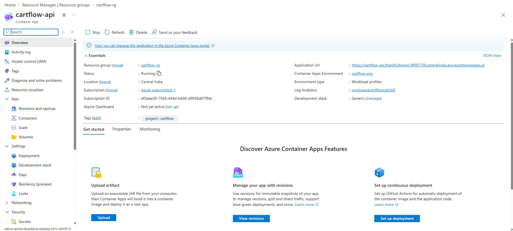


### Application endpoints

  ------------------------------------------------------------------------------------------------------------------------------------
  Endpoint                                                                                         Purpose
  ------------------------------------------------------------------------------------------------ -----------------------------------
  [Application                                                                                     Application entry point
  root](https://cartflow-api.thankfulforest-0f061758.centralindia.azurecontainerapps.io/)

  [Health                                                                                          Reports application health
  check](https://cartflow-api.thankfulforest-0f061758.centralindia.azurecontainerapps.io/health)
  ------------------------------------------------------------------------------------------------------------------------------------

The health endpoint has returned a healthy status with the API, catalog,
and orders checks marked `ok`.


## CI/CD with GitHub Actions

The application workflow is defined in `.github/workflows/ci-cd.yml`. It
validates the application, builds the Docker image, publishes it to ACR,
and deploys it to Azure Container Apps.


GitHub Actions also runs Terraform-related workflows:

-   `.github/workflows/terraform-ci.yml` --- Terraform validation and
    plan workflow.
-   `.github/workflows/terraform-apply.yml` --- manually initiated apply
    workflow with an explicit confirmation input and protected
    environment.

## Infrastructure as Code with Terraform

The Azure Terraform configuration is located in `terraform-azure/`. It
describes the Azure resources used by the project and the Container App
deployment.

Terraform uses Azure Blob Storage for remote state:

-   **Storage account:** `cartflowtfstate2026`
-   **Container:** `tfstate`
-   **State blob:** `cartflow-terraform.tfstate`

The apply workflow previously completed with
`0 added, 0 changed, 0 destroyed`, indicating that no infrastructure
changes were required at that run.

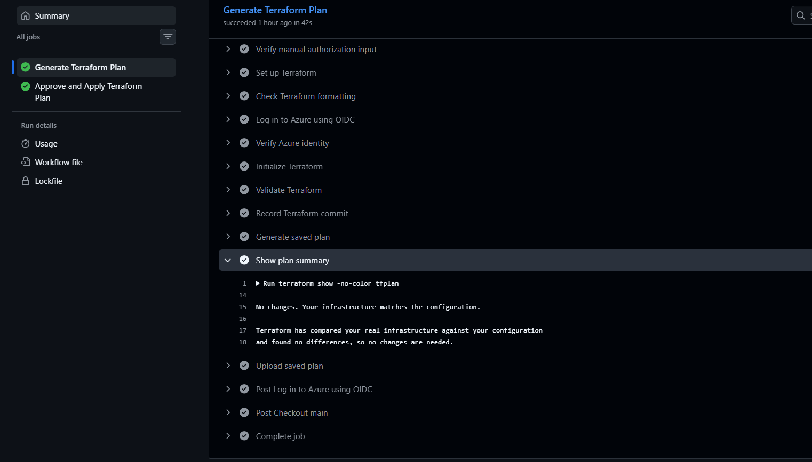

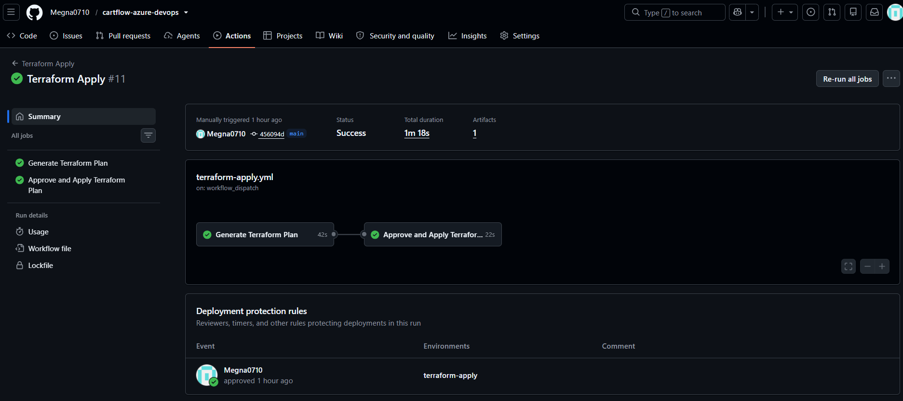

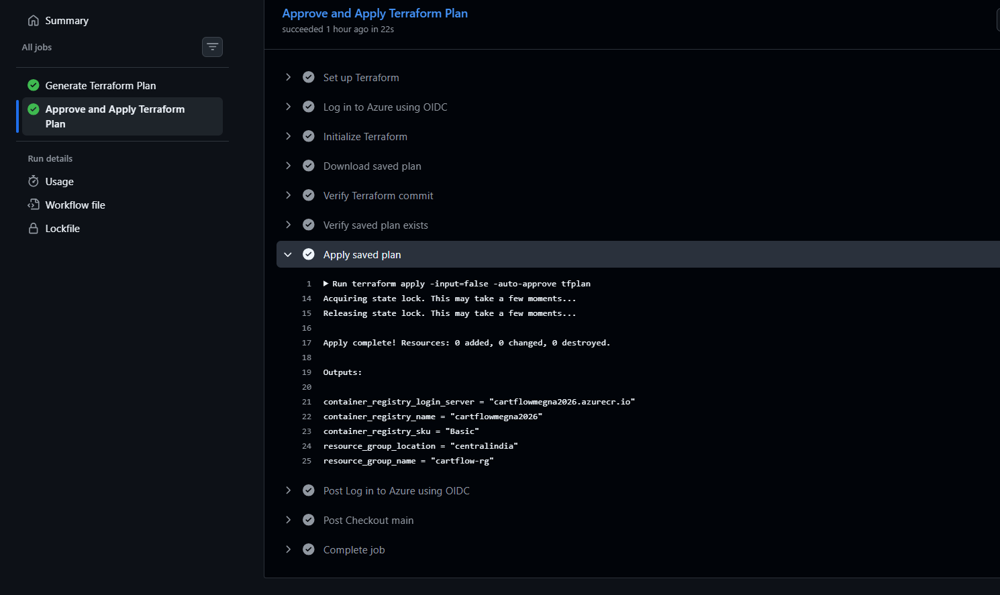


## Identity and Secret Management

GitHub Actions uses Microsoft Entra ID federated credentials (OIDC) to
authenticate to Azure, avoiding the need for a long-lived Azure client
secret for that federation flow.

The Azure app registration is `GitHubActions-CartFlow`.

Azure Key Vault `cartflow-kv-megna-2026` contains the project secret
`cartflow-demo-message`. The secret value should never be committed to
GitHub or exposed in screenshots. The existence of the secret in Key
Vault does not by itself establish that the running application
retrieves it at runtime.

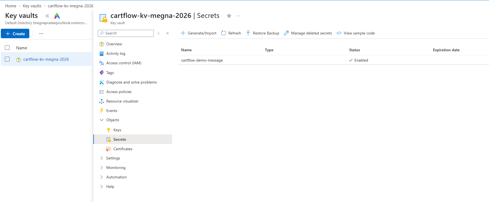

## Security

GitHub security features configured or verified for this repository
include CodeQL code scanning, Secret Protection, Push protection, and
Dependabot alerts. Security results are point-in-time snapshots and
should be reviewed as code and dependencies change.

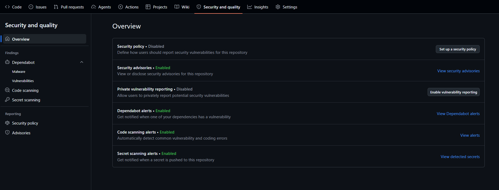


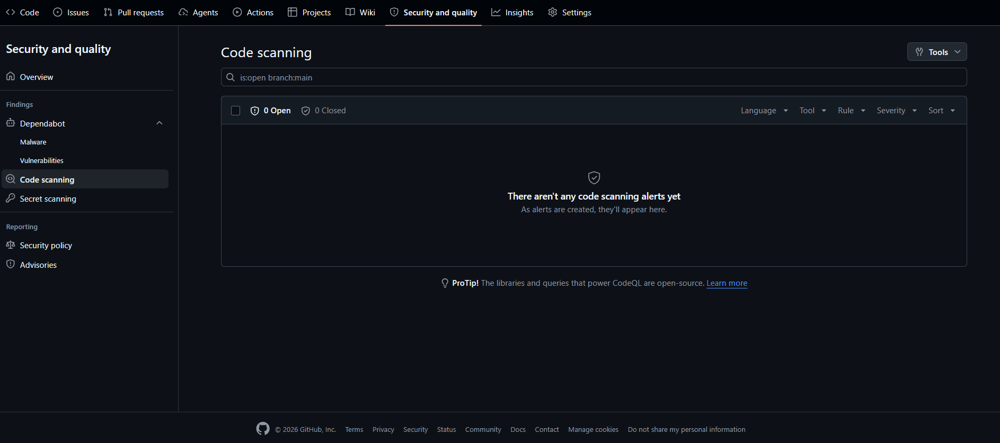

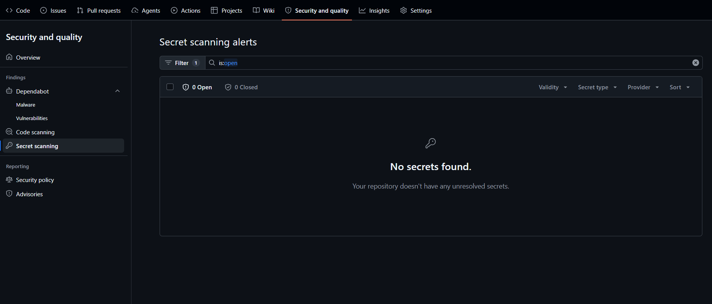

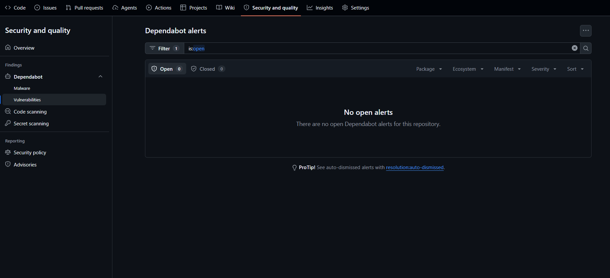


## Monitoring and Alerting

Azure Container Apps is configured to send console and system logs to
the connected Log Analytics workspace `workspacecartflowrgb3e8`.

The following tables were observed to contain records:

-   `ContainerAppConsoleLogs_CL` --- console output such as Flask
    startup messages and HTTP requests.
-   `ContainerAppSystemLogs_CL` --- container lifecycle events.

Example KQL query for recent console logs:

``` kusto
ContainerAppConsoleLogs_CL
| where TimeGenerated > ago(1h)
| project TimeGenerated, ContainerGroupName_s, Log_s
| sort by TimeGenerated desc
| take 30
```

### CPU metric and alert

The Azure Monitor metric `CPU Usage Percentage (Preview)` is available
for `cartflow-api`. The configured alert is:

-   **Alert name:** `CartFlow-High-CPU-Alert`
-   **Metric:** CPU Usage Percentage (`CpuPercentage`)
-   **Aggregation:** Average
-   **Condition:** Greater than 80%
-   **Evaluation frequency:** Every 1 minute
-   **Lookback period:** 5 minutes
-   **Severity:** 3 --- Informational
-   **Action group:** `cartflow-alerts`

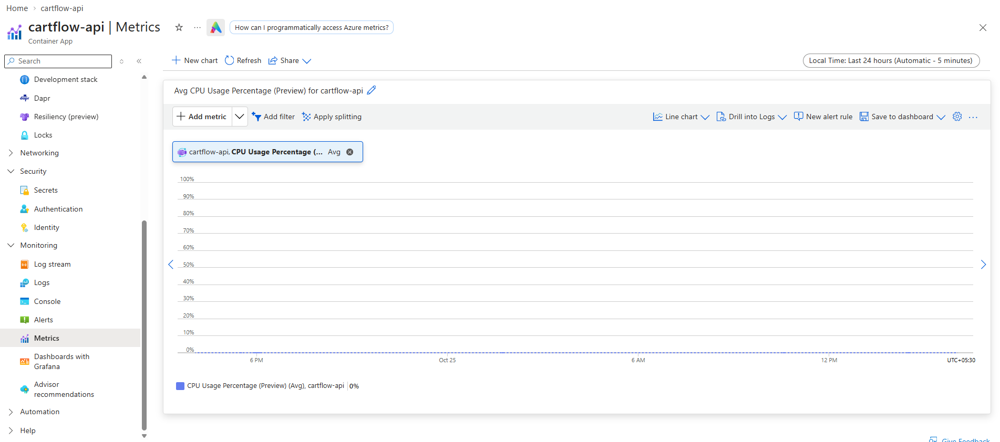


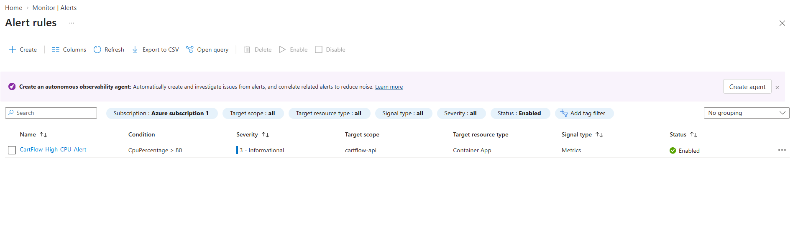

The action group has a verified email receiver named `CartFlowEmail`.
The Azure Monitor sample static-threshold action-group test completed
successfully, and the sample notification was received by email. This
verifies the notification path; it does not prove that the real CartFlow
CPU alert has fired due to CPU exceeding 80%.


## Repository Structure

``` text
cartflow-azure-devops/
├── app/
├── .github/
│   └── workflows/
├── docs/
│   └── images/
├── terraform-azure/
├── Dockerfile
└── README.md
```

## Run Locally

Create and activate a virtual environment from the repository root
(Windows Git Bash):

``` bash
python -m venv venv
source venv/Scripts/activate
pip install -r app/requirements.txt
python app/app.py
```

In another terminal, check the health endpoint:

``` bash
curl http://localhost:5000/health
```

Use the application's configured startup command if its entry point
changes.

## Key Learning Outcomes

-   Built and deployed a containerized Python API.
-   Automated application build and deployment with GitHub Actions.
-   Published container images to Azure Container Registry.
-   Managed Azure infrastructure using Terraform and remote state.
-   Configured GitHub-to-Azure OIDC federation.
-   Used Azure Key Vault for secret storage.
-   Enabled GitHub code scanning and secret protection features.
-   Queried application and system logs with KQL.
-   Configured an Azure Monitor metric alert and tested its email action
    group.

## Future Improvements

-   Run Flask behind Gunicorn or another production WSGI server.
-   Add an alert for container replica restarts after validating the
    available metric.
-   Add monitoring for failed health checks or elevated HTTP 5xx
    responses where telemetry supports it.
-   Review Azure costs and remove unused resources when the project is
    not being demonstrated.
-   Keep dependencies updated and review CodeQL and Dependabot findings
    regularly.

## Author

**Megna Pradeep**

-   GitHub: [Megna0710](https://github.com/Megna0710)
-   Repository:
    [cartflow-azure-devops](https://github.com/Megna0710/cartflow-azure-devops)
