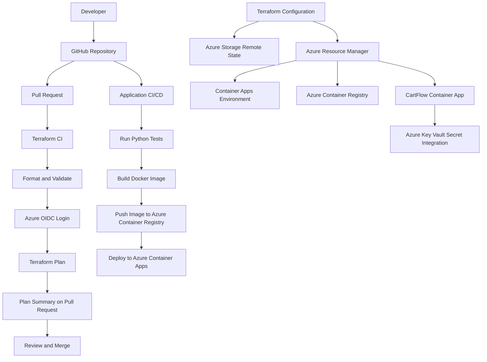

# Azure Terraform Configuration

Pull requests run Terraform formatting, validation, and plan checks before infrastructure changes are merged into main.

## Terraform Architecture

### Overview

Terraform manages the Azure infrastructure for the CartFlow application. The configuration uses Azure Storage for remote state and GitHub Actions with OpenID Connect (OIDC) for secure Azure authentication.

### Architecture Diagram

### Key Components

- **Terraform:** Defines and manages the Azure infrastructure.
- **Azure Storage:** Stores Terraform state remotely in the `tfstate` container.
- **GitHub Actions:** Automates Terraform formatting, validation, and planning.
- **OIDC:** Allows GitHub Actions to authenticate to Azure without storing a long-lived Azure client secret.
- **Azure Container Registry (ACR):** Stores the CartFlow Docker image.
- **Azure Container Apps:** Runs the CartFlow Flask application.
- **Azure Key Vault:** Stores the demo secret used by the application configuration.

### Pull Request Workflow

1. A developer creates a feature branch and opens a pull request.
2. GitHub Actions checks Terraform formatting and validates the configuration.
3. The workflow authenticates to Azure using OIDC.
4. Terraform generates a plan and posts a concise summary to the pull request.
5. The team reviews the proposed infrastructure changes before merging.

The Terraform CI workflow is plan-only and does not automatically apply infrastructure changes.

### Application Deployment Workflow

1. GitHub Actions runs the Python application tests.
2. The workflow builds a Docker image and scans it for vulnerabilities.
3. The image is pushed to Azure Container Registry.
4. The workflow updates Azure Container Apps with the new image.
5. A health-check request verifies that the application responds.

### Infrastructure State and Safety

- Terraform state is stored in Azure Storage using Azure AD authentication.
- GitHub Actions uses OIDC for Azure authentication.
- The Container App resource has `prevent_destroy = true`.
- Terraform ignores changes to the container image and secret block, which are managed separately.
- Infrastructure changes are reviewed through Terraform plans before they are applied.
